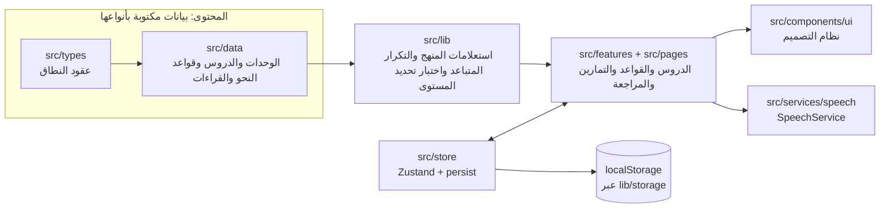
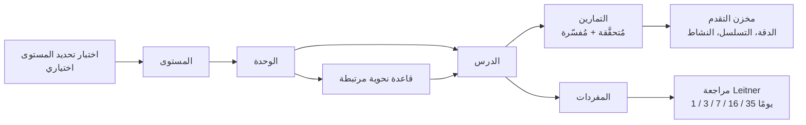

<div align="center">

# Deutsch. — تعلّم الألمانية

**منصّة منظّمة لتعلّم اللغة الألمانية ثنائية اللغة (العربية ⇄ الألمانية)، مصمّمة للدراسة الذاتية من A1 إلى B2 وفق الإطار الأوروبي المرجعي المشترك للغات (CEFR).**

العربية · [English](README.md)

<br />


</div>

---

## نظرة عامة

**Deutsch.** منصّة لتعليم الألمانية للناطقين بالعربية؛ الألمانية هي اللغة التي يتعلمها المستخدم، والعربية هي لغة الشرح. يتبع كل درس بنية تعليمية موحّدة، وتُشرح القواعد بصريًا بدلًا من عرض كتل طويلة من النصوص، ويمكن تشغيل النطق الصوتي لكل كلمة وجملة ألمانية.

تنظّم المنصّة المنهج وفق سلّم CEFR — **A1 → A2 → B1 → B2** — وتعامل المنهج على أنه *بيانات* لا شيفرات واجهة، بحيث يمكن توسيع المحتوى (أو نقله إلى API أو نظام إدارة محتوى CMS) دون لمس الواجهة.

### الحالة الحالية

|   | A1 | A2 | B1 | B2 |
| --- | :---: | :---: | :---: | :---: |
| الوحدات | 20 | 14 | — | — |
| الدروس | 31 | 14 | — | — |
| بنود المفردات | 272 | 104 | — | — |
| التمارين | 190 | 107 | — | — |
| نصوص القراءة | 17 | 18 | — | — |
| المحادثات | 40 | 41 | — | — |
| قواعد النحو المؤلَّفة (من خارطة القواعد ذات 70 قاعدة) | 16 / 16 | 18 / 18 | 0 / 17 | 0 / 19 |

محتوى المستويين **B1 وB2 مخطّط له ولم يُؤلَّف بعد**؛ لذا تعرضهما المنصّة على أنهما «قريبًا». تُحتسب جميع الأرقام من المحتوى الموجود في `src/data`.

## الميزات

- **منهج منظّم** — مستوى ← وحدة ← درس. يتضمن كل درس أهدافًا، وشرحًا، وأمثلة، ومفردات، ونصائح للنطق، وتمارين، وأخطاء شائعة، وخطوة لإكمال الدرس.
- **قسم القواعد** — تُعرض القاعدة وفق التسلسل: المفهوم ← القاعدة ← التركيب ← الأمثلة ← الاستثناءات ← الأخطاء الشائعة ← التدريب، مع تراكيب جمل ملوّنة ومخططات توضيحية.
- **محرك تمارين** — محرك واحد يعتمد على البيانات ويدعم ثمانية أنواع من التمارين: الاختيار من متعدد، وملء الفراغ، وترتيب الكلمات، والمطابقة، والترجمة، والصواب والخطأ، والاستماع، واسترجاع المفردات، مع تحقق من الإجابة وتغذية راجعة تفسيرية لكل نوع.
- **النطق** — يمكن تشغيل أي كلمة أو عبارة ألمانية بلهجة `de-DE` عبر طبقة تجريد لخدمة النطق قابلة للاستبدال (واجهة المتصفح `SpeechSynthesis` اليوم، ومزوّد TTS خارجي غدًا، دون أي تغيير في الواجهة). تعتمد جودة الصوت على الأصوات الألمانية المثبّتة على جهاز المتعلّم.
- **نصوص ومحادثات صوتية** — يحتوي كل مستوى على تبويب لنصوص القراءة والمحادثات — حوارات الدروس أولًا، ثم محادثات مستقلة أطول عن مواقف الحياة اليومية (مكالمة هاتفية، صيدلية، فندق، دائرة البلدية). يُفتح كل عنصر في صفحة تتضمن عنوانًا ألمانيًا وغلافًا والنص ومشغّل صوت عائمًا: تشغيل/إيقاف مؤقت، وشريط انتقال بين الجمل، وإعادة التشغيل، والتحكم بالسرعة (وفق الإعداد نفسه الموجود في الإعدادات)، ومفتاح لإظهار الترجمة العربية. انقر على أي جملة أو سطر لبدء القراءة منه؛ ويُميّز النص الجاري قراءته.
- **تلميحات القواعد داخل النصوص** — الصيغ التي تدفع المتعلّم إلى السؤال «لماذا؟» تحمل ثلاث نقاط صغيرة تحتها: الأدوات المندمجة (**zur** Arbeit و**im** Büro و**ins** Kino)، وحالة Dativ بعد حرف الجر (nach **dem** Frühstück وmit **meinen** Kollegen)، و«einen» للمفعول به المذكر، و«des» في Genitiv، و«in die Stadt» بعد فعل حركة، والعبارات الثابتة مثل *nach Hause* و*zu Hause*. عند تمرير المؤشر على العبارة المعلَّمة (أو لمسها على الشاشات اللمسية) يظهر سبب عربي مختصر مع الصيغة («zu + der → zur») ومع أداة تعريف الاسم متى عرفتها المفردات («das Frühstück»)؛ ومستخدم لوحة المفاتيح يرى كل تلميحات الجملة عند التركيز عليها، وقارئات الشاشة تقرؤها وصفًا للجملة. والكاشف متحفّظ عن قصد (`src/lib/grammarHints.ts` وقواعده في `src/data/grammarHints.ts`): الصيغة التي تحتمل أكثر من تفسير (مثل «den» بعد حرف جر متغيّر) لا تأخذ تلميحًا بدل تلميح مشكوك فيه. ويمكن إيقافه من الإعدادات أو بزر «تلميحات القواعد» في صفحة القصة.
- **الإملاء من نصّك الخاص** («تدريب على نصّي») — الصق أي نص ألماني، لتراه مقسّمًا إلى مقاطع قصيرة (جملةً جملة، أو عبارات قصيرة تنكسر عند الفواصل وأدوات الربط وحروف الجر، أو أسطرًا تحددها بنفسك)، فاستمع إلى كل مقطع ثم اكتبه حرفًا حرفًا. يصدر صوت خفيف عند كل حرف صحيح، ونغمة منخفضة عند الخطأ، ورنين عند انتهاء كل مقطع، ونغمة احتفالية قصيرة عند اكتمال النص؛ ويمكن إيقاف الأصوات. تُحفظ النصوص في المتصفح مع أفضل دقة وسرعة حققتهما. وتُستخدم شاشة الكتابة نفسها للإملاء من نصوص الدروس.
- **المراجعة بالتكرار المتباعد** — نظام Leitner بخمس خانات (1 / 3 / 7 / 16 / 35 يومًا): ترفع الإجابة الصحيحة الكلمة خانة، وتعيد الإجابة الخاطئة إلى الخانة 0. ويمكن إضافة أي كلمة من صفحة المفردات إلى المراجعة يدويًا.
- **جلسات تدريب أفضل** — بعد مجموعة تمارين يرى المتعلّم ما أخطأ فيه، مع الإجابة الصحيحة ورابط يعيده إلى الدرس الذي يشرحه، ويمكنه إعادة التدريب على الأخطاء وحدها (للتدريب فقط: إعادة التدريب لا تغيّر نتيجة الدرس ولا الإحصاءات ولا خانات المراجعة). مفاتيح الأرقام تختار خيارًا، وEnter يتابع، وSpace يعيد الصوت. وتُولَّد أصوات قصيرة للإجابة الصحيحة والخاطئة باستخدام Web Audio (من دون ملفات صوتية) ويمكن إيقافها.
- **تدريب على ما يجعل الألمانية صعبة** — بجانب الجلسة المختلطة و«نقاط ضعفي»: تدريبات على أداة التعريف (der / die / das)، وعلى استنتجها من نهاية الاسم (فقط الأسماء التي تشرحها قاعدة فعلًا، مع سردها للاستثناءات)، وعلى الجمع (تُبنى الخيارات الخاطئة من بقية أنماط الجمع ولا تكون كلمة حقيقية أبدًا)، وعلى أشكال الأفعال (المضارع مع تغيّر الجذر، وhaben أو sein في Perfekt، وPartizip II، وPräteritum ابتداءً من A2). يحمل كل اسم جمعه، وكل فعل صيغتيه في Perfekt وPräteritum؛ ولكل كلمة من الكلمات الـ401 جملة مثال ثنائية اللغة.
- **أرقام ووقت وتواريخ وأسعار بلا نهاية** — أسئلة مولَّدة من قواعد (لا مكتوبة واحدًا واحدًا) في `src/lib/generators`، مع اختبارات للقيم الدقيقة: تسمعها أو تقرأها أو تكتبها. يستهدف تدريب الأرقام الالتباسات الكلاسيكية (13 / 30، 16 / 60، 24 / 42)، وتُقرأ الساعة بالطريقة اليومية («halb vier» أي 3:30) وبالطريقة الرسمية بنظام الـ24 ساعة، وتتدرّب التواريخ على العدد الترتيبي وعلى «-n» في Dativ («am dritten Oktober»).
- **Du أم Sie** — اختر الصيغة المناسبة للموقف، وحوّل جملة من صيغة إلى أخرى، مع جدول يعرض كل الصيغ جنبًا إلى جنب.
- **ملاحظات للناطقين بالعربية** — داخل الدروس حيث تبدأ هذه المواضيع في الظهور أولًا: غياب فعل الكينونة في الجملة الاسمية العربية، وعدم وجود أداة نكرة، وجنسٌ لا يطابق العربية، وأسماء ألمانية بحرف كبير، وفعلٌ في المرتبة الثانية وفي نهاية الجملة، وkein / nicht، والأصوات التي تخلو منها العربية (P، وW / V، وü / ö، وصوتا ch، وتجمّعات الحروف الساكنة)، مع الكلمات لتسمعها.
- **تدريب النطق** (`/pronunciation`) — تسمع كلمة أو زوجًا أدنى أو جملة أو جملة صعبة النطق، وتنطقها، وترى أي الكلمات فُهمت (بالكلمات والأيقونات، لا باللون وحده). يمرّ التعرف عبر واجهة `SpeechRecognizer` قابلة للاستبدال (واجهة Web Speech API في المتصفح اليوم)؛ وحيث خلا المتصفح منها تشرح الصفحة أسلوب الترديد (shadowing) بدل ذلك. وتقول الصفحة بوضوح إن المتصفح قد يرسل الصوت إلى خادم مزوّده، وأن الموقع لا يخزّن أي تسجيل.
- **نقاط الضعف الإملائية** — كل إملاء، من قصة أو من نصّك الخاص، يصنّف كل حرف أخطأت فيه إملاءً (إغفال Umlaut، وß أو ss، وie / ei، وحرف ساكن مضاعف، وحرف كبير)، ويحفظ العدد والكلمات التي تتعثر فيها؛ وإملاء مخصص لهذه الكلمات ينقصها الكلمة واحدةً واحدة كلما كتبتها صحيحة.
- **تعلّم نصٍّ على مراحل** — ينتقل نصّك من النسخ، إلى ملء الفراغ (نصف الكلمات معطاة)، إلى الحروف الأولى فقط، إلى الكتابة من الذاكرة؛ واجتياز مرحلة (90 %) يرفعه إلى المرحلة التالية، وأما النجاح من الذاكرة فيجدول مراجعة بعد 1 و3 و7 و14 و30 يومًا. وتأتي النصوص المستحقة للمراجعة أولًا.
- **منتقي الأصوات** — اختر الصوت الألماني الذي تُقرأ به الدروس (مطابقة تلقائية للأفضل افتراضيًا، ومفضّلات، وزر معاينة لكل صوت).
- **اختبار تحديد المستوى** — مبنيٌّ من تمارين المنهج الحقيقية، ويوجّه فقط إلى مستويات تملك محتوى.
- **تتبّع التقدم** — الدروس المكتملة، والدقة، وتقدم المفردات، وسجلّ النشاط، وسلسلة التعلّم، كلها تُخزَّن محليًا في المتصفح. يمكن تصدير التقدم والإحصاءات ونصوصك الخاصة ونتائج الإملاء ونقاط الضعف الإملائية واستيرادها (مع تحقق عبر Zod)؛ والملف الأقدم لا يمحو جزءًا لا يحمله أبدًا.
- **بصيرة لا تحفيزًا بالألعاب** — حلقة هدف يومي، وخريطة حرارية لنشاط 20 أسبوعًا، ودقة حسب نوع التمرين وحسب الموضوع، وسبر المفردات المستراجعة عبر خانات Leitner. وبطاقة ترحيب في الاستخدام الأول تضبط الهدف اليومي ونقطة البداية.
- **البحث** (`Ctrl/⌘ + K` أو «/») عبر الدروس وقواعد النحو والمفردات والنصوص، بمطابقة الألمانية والعربية مع أو بدون أداة التعريف، ومع Umlaut وعلامات الحركات. ويُحمَّل كسولًا كي لا ينفخ التحميل الأول.
- **تنضيد ثنائي اللغة متقن** — العربية RTL والألمانية LTR، والألمانية المقتبسة داخل النص العربي معزولة كي لا تنتقل علامات الترقيم إلى الجهة الأخرى.
- **مظهر فاتح / داكن / تابع للنظام** مع متغيرات تصميم وتباين WCAG AA، إضافة إلى إعداد بحجم النص (100 / 112 / 125 %) ووضع تباين عالٍ.
- **متجاوب مصمم للهواتف أولًا** — شريط سفلي للهواتف وشريط جانبي لسطح المكتب، وأهداف لمس ≥ 44 بكسل، ودعم تقليل الحركة.
- **تطبيق ويب قابل للتثبيت (PWA)** — عامل خدمة يدعم العمل دون اتصال، وتنبيه بوجود تحديث، وإشعار عند عدم الاتصال. الخطوط مستضافة محليًا، فلا ينتظر أول ظهور أي طرف من أطراف ثالثة.

## لقطات الشاشة

> تستخدم لقطات الشاشة ملفًا لمتعلّم نموذجي (خمسة دروس مكتملة وسلسلة تعلّم من خمسة أيام) حتى تكون مشاهد التقدم ممتلئة بالبيانات.

<table>
  <tr>
    <td width="50%"><br /><br /><sub><b>الدرس</b> — أهداف، وشرح مع فهرس داخل الصفحة، ونص عربي/ألماني مختلط</sub></td>
    <td width="50%"><br /><br /><sub><b>قاعدة نحوية</b> — نتائج التعلم وكتل الجمل وتبويبات الأقسام</sub></td>
  </tr>
  <tr>
    <td width="50%"><br /><br /><sub><b>التمارين</b> — تحقق فوري مع شرح</sub></td>
    <td width="50%"><br /><br /><sub><b>المستوى</b> — وحدات ودروس، مع تبويب النصوص والمحادثات</sub></td>
  </tr>
  <tr>
    <td width="50%"><br /><br /><sub><b>التقدم</b> — السلسلة والدروس المكتملة والتقدم لكل مستوى والنشاط</sub></td>
    <td width="50%"><br /><br /><sub><b>المراجعة</b> — كلمات مستحقة اليوم</sub></td>
  </tr>
  <tr>
    <td width="50%"><br /><br /><sub><b>النصوص والمحادثات</b> — نصوص القراءة والمحادثات في تبويب واحد</sub></td>
    <td width="50%"><br /><br /><sub><b>نص قراءة</b> — غلاف، وصوت للجمل بجملة، وترجمة عربية</sub></td>
  </tr>
  <tr>
    <td colspan="2" align="center"><br /><br /><sub><b>المحادثة</b> — كل سطر قابل للنقر، وللمتحدثين نغمة صوت مختلفة</sub></td>
  </tr>
</table>

<div align="center">
  
  <br /><br /><sub><b>الهواتف</b> — لوحة التحكم (داكنة)، ودرس (فاتح)، وقاعدة نحوية (داكنة)</sub>
  <br /><br />
  
  <br /><br /><sub><b>الهواتف</b> — قائمة النصوص والمحادثات (فاتحة)، ونص قراءة (داكن)، ومحادثة (فاتح)؛ ويقع شريط الصوت فوق شريط التنقل السفلي</sub>
</div>

## التقنيات المستخدمة

<table align="center">
  <tr>
    <td align="center" width="120"><br /><b>React 19</b><br /><sub>واجهة المستخدم</sub></td>
    <td align="center" width="120"><br /><b>TypeScript</b><br /><sub>أنواع صارمة</sub></td>
    <td align="center" width="120"><br /><b>Vite 8</b><br /><sub>أداة البناء</sub></td>
    <td align="center" width="120"><br /><b>Tailwind CSS 4</b><br /><sub>تنسيق + متغيرات التصميم</sub></td>
  </tr>
  <tr>
    <td align="center" width="120"><br /><b>Zustand 5</b><br /><sub>حالة العميل</sub></td>
    <td align="center" width="120"><br /><b>React Router 7</b><br /><sub>التوجيه</sub></td>
    <td align="center" width="120"><br /><b>Zod 4</b><br /><sub>تحقق من البيانات</sub></td>
    <td align="center" width="120"><br /><b>Lucide</b><br /><sub>الأيقونات</sub></td>
  </tr>
  <tr>
    <td align="center" width="120"><br /><b>Vitest 4</b><br /><sub>اختبارات وحدة</sub></td>
    <td align="center" width="120"><br /><b>Testing Library</b><br /><sub>اختبارات المكونات</sub></td>
    <td align="center" width="120"><br /><b>Playwright</b><br /><sub>شاملة من طرف إلى طرف</sub></td>
    <td align="center" width="120"><br /><b>axe-core</b><br /><sub>تدقيق إمكانية الوصول</sub></td>
  </tr>
  <tr>
    <td align="center" width="120"><br /><b>Oxlint</b><br /><sub>فحص الشيفرة</sub></td>
    <td align="center" width="120"><br /><b>vite-plugin-pwa</b><br /><sub>دون اتصال + تثبيت</sub></td>
    <td align="center" width="120"><br /><b>Google Fonts</b><br /><sub>الخطوط</sub></td>
    <td align="center" width="120"><br /><b>GitHub Actions</b><br /><sub>التكامل المستمر</sub></td>
  </tr>
</table>

<sub>الأيقونات: العلامات الرسمية من <a href="https://simpleicons.org">Simple Icons</a> (رخصة CC0). لا يوجد في المكتبة مدخل لـ Zustand أو Playwright أو axe-core، لذا تُعرض كبلاطات أحرف محايدة بدلًا من محاكاة شعاراتها.</sub>

**الخطوط** — Reem Kufi (العناوين العربية)، وIBM Plex Sans Arabic (المتون العربية)، وFraunces (الألمانية)، وIBM Plex Mono (علم الأصوات).

اعتماديات تُبقى قليلة عمدًا: اعتماديات التشغيل هي React وReact Router وZustand وZod وLucide. أما كل ما عداها فأدوات تطوير.

## كيف يعمل التطبيق

### البنية المعمارية

طبقات المحتوى والمنطق والحالة والواجهة منفصلة، والاعتماديات لا تشير إلا في اتجاه واحد.



- **المحتوى بيانات.** الدروس كائنات موصوفة بالأنواع في `src/data`، لا JSX. مجموعة اختبارات سلامة المحتوى تتحقق من المنهج كله — فمثلًا خيارات مكررة في سؤال اختيار من متعدد أو روابط مكسورة بين الدروس وقواعد النحو تُفشل الاختبارات (وبالتالي CI). وإذا انتقل المحتوى إلى API أو CMS فالأمر يقتصر على تغيير طبقة الوصول إلى البيانات في `src/lib/curriculum.ts`، لا الواجهة.
- **المحتوى يُحمَّل لكل مستوى.** `data/curriculum.ts` سجلّ صغير يجلب محتوى كل مستوى كتقسيمته الخاصة عند أول حاجة إليه (`CurriculumGate` في الموجّه). حزمة الإدخال لا تحمل أية بيانات دروس، وإضافة B1 أو B2 تعني إضافة محمّل واحد هناك. وتُحمَّل قواعد النحو كسولًا بالطريقة نفسها.
- **الحالة صغيرة ومنفصلة.** مخازن Zustand منفصلة تتولى التقدم، وإحصاءات التعلّم (`statsStore`: الإجابات يوميًا وحسب نوع التمرين والموضوع)، وتقدم القواعد، والإعدادات، والمظهر. وكل عمليات الحفظ تمر عبر وحدة واحدة (`lib/storage.ts`) تتراجع إلى الذاكرة إذا لم يكن `localStorage` متاحًا، فالتصفح الخاص لا يكسر التطبيق أبدًا.
- **الخدمات تخفي المزوّدين.** تستدعي مكونات الواجهة `speechService` (النطق، وسرد الأصوات، واختيار صوت) و`soundService` (أصوات التغذية الراجعة)؛ ولا يعرف `BrowserSpeechService` إلا `SpeechSynthesis`، ولا `WebAudioSoundService` إلا Web Audio.
- **نموذج عرض واحد للنصوص والمحادثات.** يحوّل `lib/stories.ts` كلًا من نوعَي المحتوى إلى `Story` (كتل + مقاطع صوتية مرقّمة)؛ فتخدم صفحة واحدة، ومشغّل واحد، وقائمة واحدة كليهما. تُقصَّم نصوص القراءة إلى جمل؛ وتُشغَّل المحادثات سطرًا سطرًا.
- **تُقسَّم المسارات إلى حزم.** تُحمَّل الصفحات — وكل قاعدة نحوية — عند الطلب.

### رحلة المتعلّم



يمرّ كل درس بـ: **الأهداف ← الشرح ← الأمثلة ← المفردات ← النطق ← التمارين ← الأخطاء الشائعة ← المراجعة والإكمال**. لا يتفعّل زر الإكمال إلا بعد إنجاز تمارين الدرس، وترتبط الدروس بقاعدة النحو التي تشرحها (والعكس كذلك).

### بنية المشروع

```text
src/
├── components/     # هيكل التخطيط وعناصر نظام التصميم (ui/)
├── data/           # المنهج كبيانات موصوفة بالأنواع: a1/, a2/, grammar/, reading
├── features/       # لوحة التحكم والدرس والقواعد والتمارين والقصص (نصوص + محادثات) والمراجعة والتقدم، …
├── hooks/          # خطّافات مشتركة (النطق والصوت والأصوات والمفضّلات وتحميل المنهج وحالة الاتصال)
├── lib/            # منطق خالص: استعلامات المنهج والتكرار المتباعد واختبار المستوى والتخزين
├── pages/          # مكونات على مستوى المسارات
├── routes/         # تعريف الموجّه
├── services/       # طبقات تجريد لخدمتَي النطق والصوت
├── store/          # مخازن Zustand (التقدم، الإحصاء، الإعدادات، المظهر، تقدم القواعد، …)
├── styles/         # متغيرات التصميم (فاتح/داكن/تباين عالٍ) ووجهات الخطوط المضمنة
├── types/          # أنواع النطاق
└── utils/          # مساعدات صغيرة (اتفاق الأعداد العربية، التواريخ، الخلط العشوائي)
e2e/                # اختبارات Playwright: التنقل وإمكانية الوصول وروابط القواعد والقصص ومسارات الميزات
docs/               # ملاحظات التصميم وخارطة القواعد ولقطات الشاشة
```

## البدء

**المتطلبات:** Node.js `^20.19.0` أو `>=22.12.0` (انظر `.nvmrc`) وnpm.

```bash
npm ci          # تثبيت ما يحدّده ملف القفل تمامًا
npm run dev     # http://localhost:3000
```

| الأمر | وظيفته |
| --- | --- |
| `npm run dev` | تشغيل خادم التطوير (المنفذ `3000`، ويمكن تجاوزه بـ `DEV_PORT`) |
| `npm run build` | فحص الأنواع، ثم إنتاج نسخة الإنتاج في `dist/` |
| `npm run preview` | تقديم نسخة الإنتاج محليًا على المنفذ `4173` |
| `npm run typecheck` | `tsc -b --noEmit` |
| `npm run lint` | Oxlint |
| `npm test` | اختبارات الوحدة والمكونات (Vitest) |
| `npm run test:e2e` | اختبارات نهاية-إلى-نهاية وإمكانية الوصول (Playwright) |

انسخ `.env.example` إلى `.env` لتجاوز الإعدادات المحلية. لا يحتاج التطبيق إلى **أي متغيرات بيئة** كي يُبنى أو يعمل.

<details>
<summary><b>استكشاف الأخطاء: <code>listen EACCES: permission denied</code> على Windows</b></summary>

يستطيع Windows حجز نطاقات من المنافذ (عادةً لأجل Hyper-V / WSL)، وقد يقع المنفذ الافتراضي لـ Vite وهو `5173` داخل أحدها. لا يعيد Vite المحاولة إلا إذا كان المنفذ *مستخدمًا* (`EADDRINUSE`)، لا إذا كان *محظورًا* (`EACCES`)، فيفشل فورًا. يستخدم هذا المشروع المنفذ `3000` افتراضيًا ويترك لك تغييره:

```bash
# اعرض نطاقات المنافذ التي حجزها Windows
netsh interface ipv4 show excludedportrange protocol=tcp

# اختر أي منفذ خارجها
DEV_PORT=4000 npm run dev            # macOS / Linux
$env:DEV_PORT=4000; npm run dev      # PowerShell
```

يمكنك أيضًا وضع `DEV_PORT=4000` في ملف `.env`.
</details>

## الجودة

- **سلامة الأنواع:** TypeScript صارم عبر التطبيق والاختبارات وإعدادات الأدوات.
- **اختبارات الوحدة والمكونات:** 927 اختبارًا في 99 ملفًا، من بينها اختبار دخان (smoke test) لكل درس، ومجموعات اختبارات لسلامة المحتوى على المنهج وقواعد النحو.
- **اختبارات نهاية-إلى-نهاية:** اختبارات Playwright على مقاسات سطح المكتب والهواتف — كل مسار يُعرض دون تجاوز أفقي، والمسارات غير المعروفة تُظهر صفحة 404، والدروس وقواعد النحو ترتبط بعضها مع بعض، وللميزات الجديدة اختبارات رحلة، كما تغطي تدقيقات **axe-core وفق WCAG 2.1 AA** المظهرين الفاتح والداكن، بما يشمل التباين العالي والنص الكبير أيضًا.
- **التكامل المستمر:** يُشغّل GitHub Actions فحص الأنواع وفحص الشيفرة والاختبارات والبناء مع كل دفعة (push) وطلب دمج (pull request)، ثم مجموعة Playwright.

## النشر

ناتج البناء تطبيق أحادي الصفحة ثابت (`dist/`)، فأي مستضافة ثابتة تصلح. ولأن التوجيه من جهة العميل (`createBrowserRouter`)، يجب أن تقدّم المستضافة `index.html` للمسارات غير المعروفة — وإلا فتحديث الصفحة على `/levels/a1` يعيد 404.

| المنصة | الإعداد |
| --- | --- |
| **Vercel** | استورد المستودع. يوفّر `vercel.json` إعادة كتابة SPA، وترويسات التخزين المؤقت، وترويسات الأمان. |
| **Netlify** | استورد المستودع. يوفّر `netlify.toml` إعدادات البناء، وإعادة توجيه SPA، والترويسات. |
| **Cloudflare Pages** | أمر البناء `npm run build`، ومجلد الإخراج `dist`. يُعامل المشروع بوصفه تطبيقًا أحادي الصفحة إذا لم يوجد ملف `404.html` في المستوى الأعلى، فلا حاجة إلى ملف إضافي. |
| **أي مستضافة ثابتة أخرى** | ارفع `dist/` وأضف قاعدة إعادة كتابة من كل المسارات إلى `/index.html`. |

ملاحظات:

- انشر عند **جذر النطاق**. يستخدم بيان PWA مسارات مطلقة (`start_url: /dashboard`)؛ والاستضافة تحت مسار فرعي تتطلب خيار `base` في Vite وتعديلات على البيان.
- الملفات ذات الأسماء المُجزَّأة (hashed) في `/assets` تُخزَّن مؤقتًا لمدة سنة؛ أما `sw.js` والبيان فيُعاد التحقق منهما دائمًا كي تصل التحديثات إلى المستخدمين.
- لم تُضبَط سياسة أمان المحتوى (Content-Security-Policy) بعد. يحمّل التطبيق Google Fonts ونص تهيئة المظهر مضمّنًا، لذا تحتاج أي CSP إلى hash لذلك النص — وهي خطوة تحصين تستحق الاهتمام.

## خارطة الطريق

- تأليف محتوى **B1** و**B2** (وحدات، دروس، مفردات، تمارين).
- استكمال خارطة القواعد: كُتبت 34 قاعدة من أصل 70 (كامل A1 وA2)؛ وتبقى قواعد B1 وB2.
- تحميل منهج كل مستوى عند الطلب — هو حاليًا مُضمَّن في الحزمة الرئيسية (انظر الدرس 7 أدناه).
- إضافة نصوص قراءة أكثر (خمسة وثلاثون حتى الآن: سبعة عشر في A1 وثمانية عشر في A2)، ورسوم حقيقية لأغلفة القصص — حقل `image` في القصة مدعوم بالفعل؛ ومن دونه يعرض الغلاف موجًا صوتية.
- تقييم مزوّد TTS خارجي خلف واجهة `SpeechService` القائمة، وتوليد الصوت مسبقًا للمحتوى الأساسي حتى يسمع كل متعلّم الصوت نفسه (يلزم مزوّد يسمح ترخيصه بتخزين الصوت).
- تنمية المفردات نحو قوائم كلمات Goethe (نحو 650 كلمة لـ A1، ونحو 650 كلمة أخرى لـ A2؛ وفي التطبيق 401)، وإتاحة إضافة كلمات المتعلّم من نصوصه الخاصة إلى مراجعة التكرار المتباعد.
- مزامنة اختيارية بين الأجهزة (تتطلب خادمًا خلفيًا وحسابات؛ وحتى ذلك الحين تصدير واستيراد).

## الدروس المستفادة

1.  **تعامل مع المحتوى كبيانات — واختبره كما تُختبر الشيفرة.** أتاح الاحتفاظ بالدروس كبيانات موصوفة بالأنواع تشغيل مجموعة اختبارات سلامة على المنهج كاملًا. واكتشفت الاختبارات عيوبًا حقيقية (مثل خيارات مكررة في أسئلة الاختيار من متعدد) لا يلاحظها أحد بقراءة الدروس واحدًا تلو الآخر.
2.  **اختبارات ناجحة لا تعني منتجًا يعمل.** كان فحص الأنواع وفحص الشيفرة (linting) و218 اختبارًا والبناء كلها ناجحة، بينما كان النص الألماني المقتبس داخل الفقرات العربية يعرض علامات الترقيم في الجهة الخاطئة. لم يظهر الخلل إلا عند فتح نسخة الإنتاج في متصفح حقيقي. لذلك فإن الفحص البصري في الاتجاهين (RTL وLTR) جزء من تعريف «العمل المكتمل».
3.  **النص ثنائي الاتجاه مشكلة عرض، فالحل في أداة العرض.** ظهر النمط نفسه في مئات السلاسل النصية المؤلَّفة. بدلًا من تعديلها واحدًا واحدًا، يُغلَّف النص اللاتيني المقتبس بعازل LTR من مكوّن واحد (`InlineMarkup`)، مع اختبارات وحدة للحالات الحدية (علامات اقتباس غير متوازنة، واقتباس عربي، وأدوات ربط ملتحمة باقتباس).
4.  **إمكانية الوصول أسهل قرارًا في متغيرات التصميم منها ترقيعًا لاحقًا.** أزواجُ ألوان فُحص تباينُها، إضافةً إلى مستوى ألوان «حيوي» منفصل محجوز للزخرفة غير النصية، عالَجت واجهةً باهتة دون التفريط في تباين النص، وتُبقيه تدقيقات axe الآلية على ذلك.
5.  **اجعل الاعتماديات تكسب مكانها.** ظلّت Zod بلا استخدام حتى أعطاها تصدير التقدم واستيراده عملًا حقيقيًا (التحقق من ملفات لا يمكن الوثوق بها). والبحث يُحمَّل كسولًا كي لا تثقل ميزةٌ عامة الرسمَ الأول.
6.  **ضع الفواصل حيث التغيير مرجّح.** خدمة النطق ووحدة التخزين هما مدخلا واجهات المتصفح إلى التطبيق. وكلاهما خلف واجهات صغيرة، ولهذا فإن استبدال مزوّد TTS أو النجاة من تخزين محجوب يكادان لا يكلفان شيئًا.
7.  **قِس حجم الحزمة ثم قرر.** حذّر البناء من حزمة بحجم 750 كيلوبايت. السبب معماري — المنهج كله مستورد ساكنًا — لذا فإن رفع حد التحذير لا يفعل شيئًا سوى إخفائه. فصل شيفرات أطراف ثالثة في حزم مستقلة يحسّن التخزين المؤقت بين عمليات النشر ويزيل التحذير بصورة مشروعة (بكلفة تنزيلٍ أولٍ أكبر قليلًا)؛ والحل الأصلي، التحميل الكسول لكل مستوى، على خارطة الطريق.
8.  **اعرف أنماط فشل أدواتك.** يعيد Vite المحاولة على منفذ مشغول ولا يفعل ذلك على منفذ محظور، فيبدو حجز Windows لنطاقات المنافذ انهيارًا غامضًا. منفذ قابل للضبط مع توثيق طريقة الفحص يحوّلان العائق إلى إصلاح من سطر واحد.
9.  **اختر النموذج الأبسط ووثّق السبب.** يستخدم التكرار المتباعد نظام خانات Leitner بدل نموذج SM-2 الكامل بعوامل السهولة، لأنه أسهل في الاستيعاب والاختبار مع الحفاظ على الفائدة الأساسية؛ والتفسير موجود في الشيفرة بجوار الفواصل الزمنية.
10. **نمذج التجربة لا نوع الملف.** تُؤلَّف نصوص القراءة والمحادثات بطرائق مختلفة، لكن المتعلّم يفعل بهما الشيء نفسه: القراءة متتبعًا الصوت. نموذج عرض صغير باسم `Story` يتيح لصفحة واحدة ومشغّل واحد وقائمة واحدة خدمة كليهما دون لمس البيانات المؤلَّفة.
11. **الإجراء الملغى ليس إجراءً فاشلًا.** تبلّغ المتصفحات عن نُطق استُبدل أو أُوقف بوصفه خطأ (`canceled` / `interrupted`)؛ ولو عُولج كفشل لومض رسالة خطأ كلما قفز المتعلّم إلى جملة أخرى، فأصبحت خدمة النطق تعامله بوصفه نهاية عادية — مع اختبارات.
12. **لا تُخفِ عيبًا بالتنسيق.** كان نمط `hover` يتغلغل بصمت على تمييز الجملة الجارِ قراءتها، ولم تُظهر ذلك إلا صورة من الصفحة الحقيقية. دخل الإصلاح واختبار انحدار معًا.

## التوثيق

- [`docs/ui-design.md`](docs/ui-design.md) — النظام البصري وأدوار الخطوط وقواعد السلوك.
- [`docs/grammar-roadmap.md`](docs/grammar-roadmap.md) — ترتيب القواعد النحوي ذو 70 قاعدة الذي تتبعه المنصّة.

## الترخيص

لم يُختر ترخيص بعد؛ وتظل جميع الحقوق محفوظة إلى أن يُضاف ملف `LICENSE`.
