<div align="center">

# Deutsch. — Learn German

**A structured, bilingual (Arabic ⇄ German) German-learning platform, built for self-study from CEFR A1 to B2.**

[العربية](README.ar.md) · English

<br />

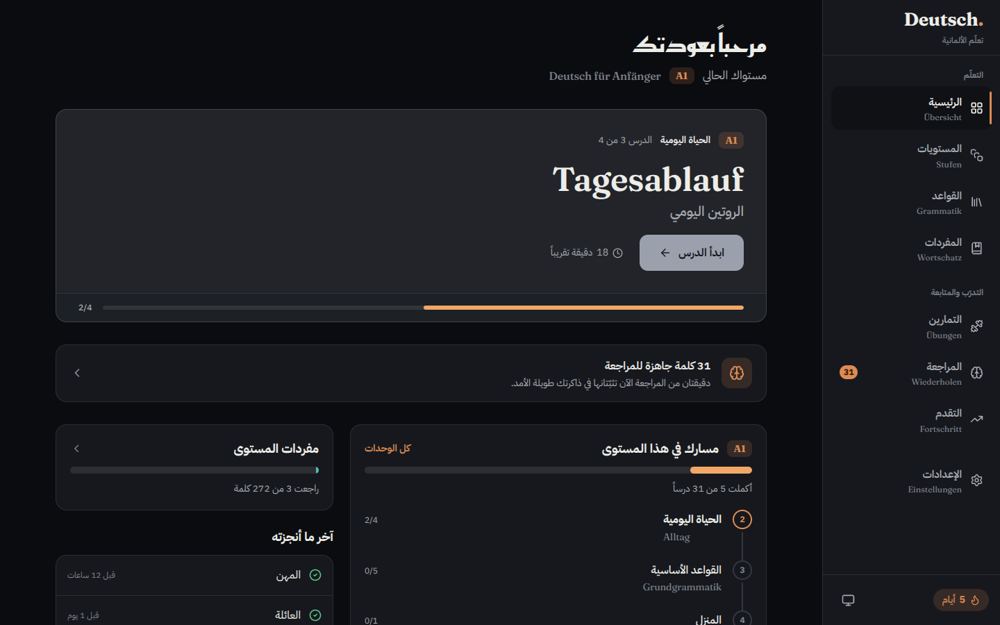

</div>

---

## Overview

**Deutsch.** teaches German to Arabic speakers. German is the language being learned; Arabic is the language of explanation. Every lesson follows the same pedagogical structure, grammar is taught visually rather than as walls of text, and every German word and sentence can be spoken aloud.

The product is organised around the CEFR ladder — **A1 → A2 → B1 → B2** — and treats the curriculum as *data*, not as UI code, so content can grow (or move to an API/CMS) without touching the interface.

### Current status

| | A1 | A2 | B1 | B2 |
| --- | :---: | :---: | :---: | :---: |
| Modules | 20 | 14 | — | — |
| Lessons | 31 | 14 | — | — |
| Vocabulary items | 272 | 104 | — | — |
| Exercises | 190 | 107 | — | — |
| Reading texts | 2 | 3 | — | — |
| Conversations | 34 | 27 | — | — |
| Grammar rules authored (of the 70-rule roadmap) | 16 / 16 | 18 / 18 | 0 / 17 | 0 / 19 |

B1 and B2 are **planned, not yet authored**; the app shows them as “coming soon”. All figures are computed from the content in `src/data`.

## Features

- **Structured curriculum** — Level → Module → Lesson, each lesson with objectives, explanation, examples, vocabulary, pronunciation tips, exercises, common mistakes and a completion step.
- **Grammar section** — rules taught as concept → rule → structure → examples → exceptions → common mistakes → practice, with colour-coded sentence structures and diagrams.
- **Exercise engine** — one data-driven engine for eight exercise types: multiple choice, fill-in-the-blank, word ordering, matching, translation, true/false, listening and vocabulary recall, each with validation and explanatory feedback.
- **Pronunciation** — any German word or phrase can be played in `de-DE` through a replaceable speech-service abstraction (browser `SpeechSynthesis` today, an external TTS provider tomorrow, with no UI changes). Voice quality depends on the German voices installed on the learner's device.
- **Texts & conversations with audio** — one tab per level lists its reading texts and conversations. Each opens as a page with a German title, a cover, the text and a floating audio player: play/pause, a seek bar over the sentences, replay, speed (the same setting as in Settings) and a switch for the Arabic translation. Tap any sentence or line to start reading from it; the one being read is highlighted.
- **Spaced-repetition review** — a five-box Leitner system (1 / 3 / 7 / 16 / 35 days): a correct answer moves a word up a box, a wrong one sends it back to box 0.
- **Placement test** — built from the real curriculum exercises and routed only into levels that have content.
- **Progress tracking** — completed lessons, accuracy, vocabulary progress, activity log and a learning streak, stored locally in the browser. Progress can be exported and imported (validated with Zod).
- **Search** across levels, lazy-loaded so it never inflates the first load.
- **Bilingual typography done right** — Arabic is RTL, German is LTR, and quoted German inside Arabic prose is isolated so punctuation never jumps sides.
- **Light / dark / system themes** with design tokens and WCAG AA contrast.
- **Responsive, mobile-first** — bottom navigation on phones, sidebar on desktop, touch targets ≥ 44 px, reduced-motion support.
- **Installable PWA** — service worker with offline support and an update prompt.

## Screenshots

> Screenshots use a sample learner profile (five completed lessons, a five-day streak) so the progress views are populated.

<table>
  <tr>
    <td width="50%">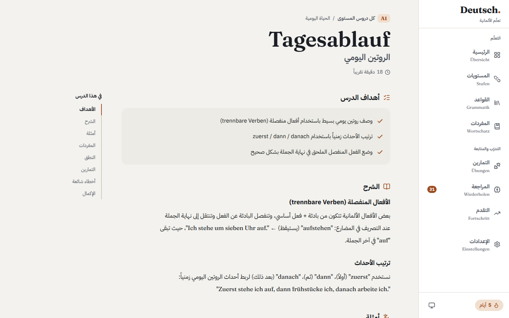<br /><br /><sub><b>Lesson</b> — objectives, explanation with an in-page outline, mixed Arabic/German text</sub></td>
    <td width="50%">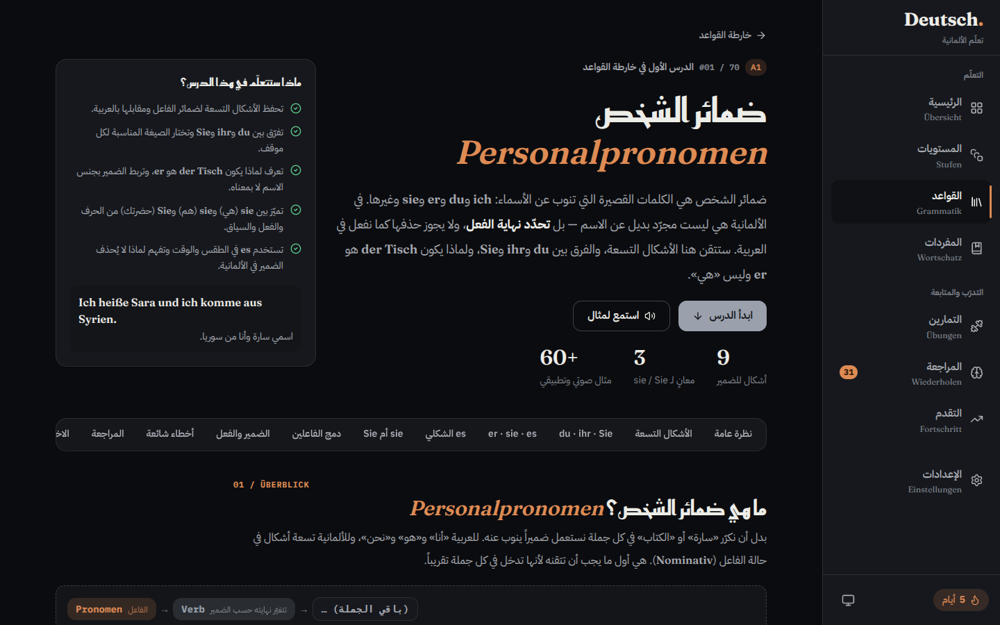<br /><br /><sub><b>Grammar rule</b> — outcomes, sentence blocks, section tabs</sub></td>
  </tr>
  <tr>
    <td width="50%">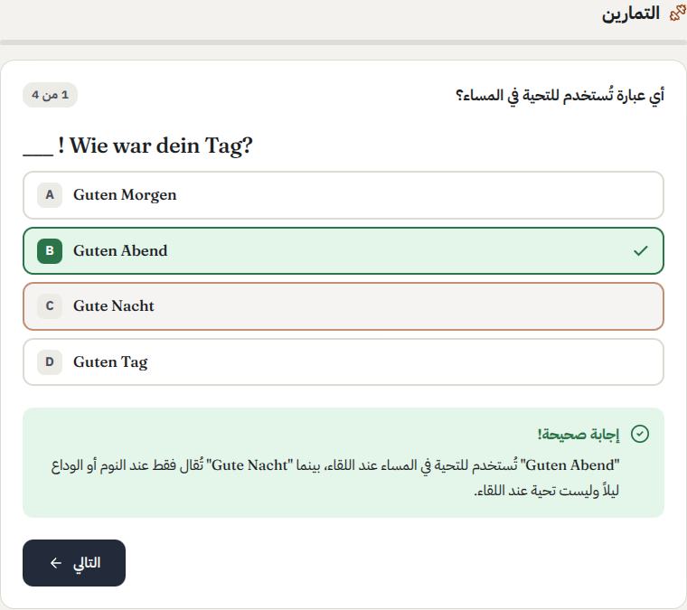<br /><br /><sub><b>Exercises</b> — instant validation with an explanation</sub></td>
    <td width="50%">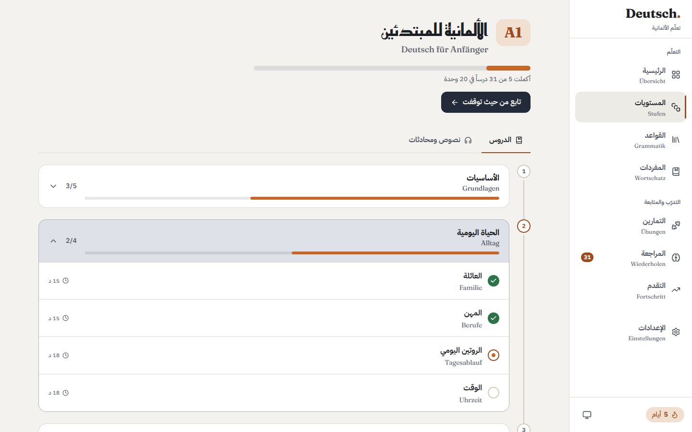<br /><br /><sub><b>Level</b> — modules and lessons, plus the texts &amp; conversations tab</sub></td>
  </tr>
  <tr>
    <td width="50%">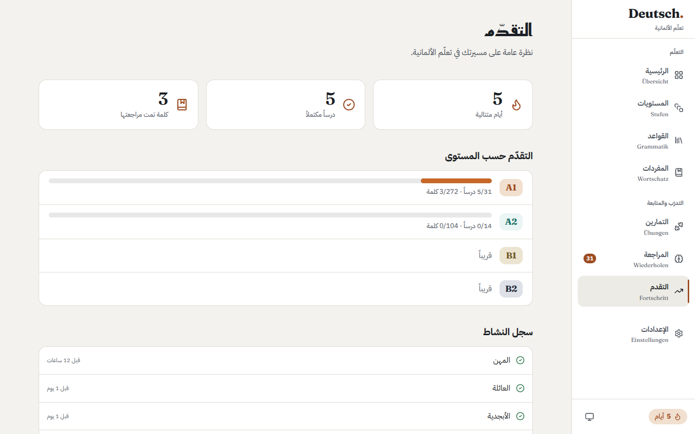<br /><br /><sub><b>Progress</b> — streak, completed lessons, per-level progress, activity</sub></td>
    <td width="50%">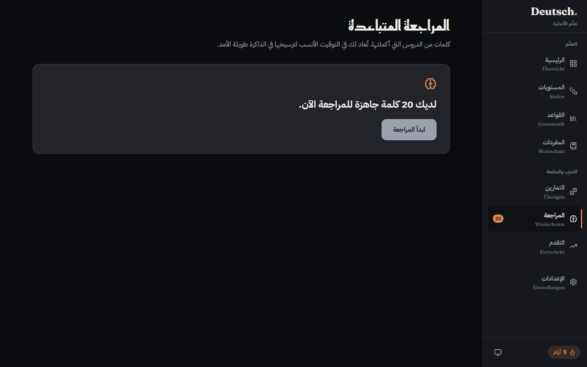<br /><br /><sub><b>Review</b> — words due today</sub></td>
  </tr>
  <tr>
    <td width="50%">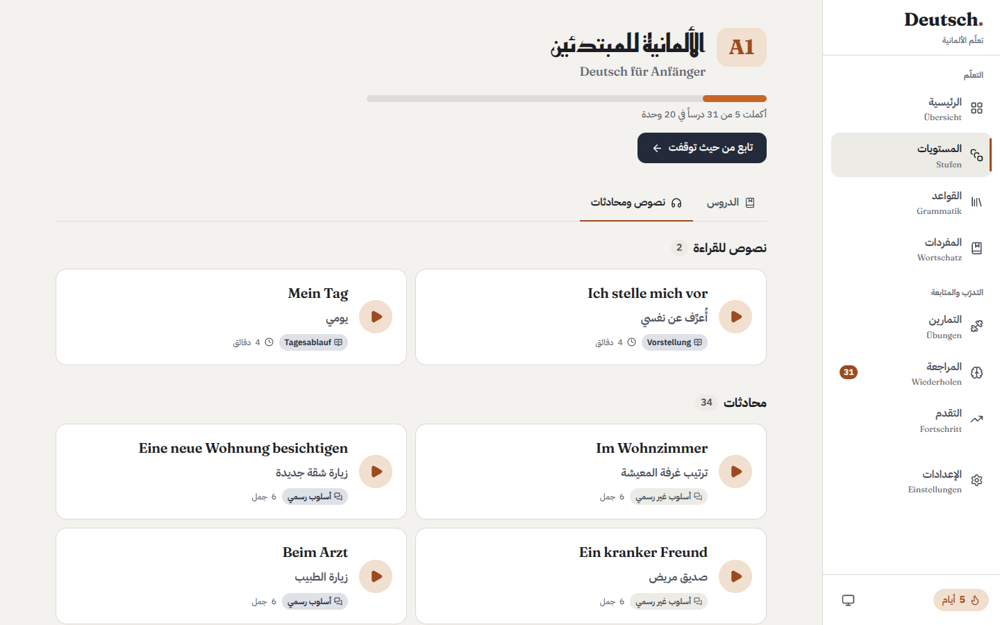<br /><br /><sub><b>Texts &amp; conversations</b> — reading texts and conversations in one tab</sub></td>
    <td width="50%">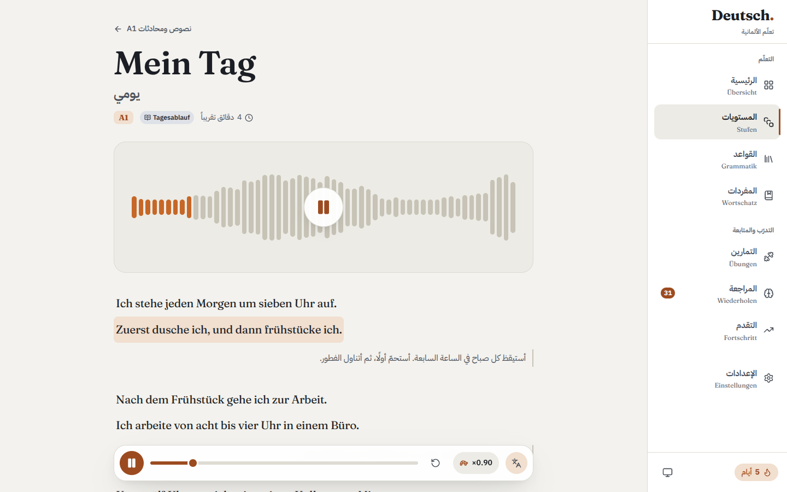<br /><br /><sub><b>Reading text</b> — cover, sentence-by-sentence audio, Arabic translation</sub></td>
  </tr>
  <tr>
    <td colspan="2" align="center">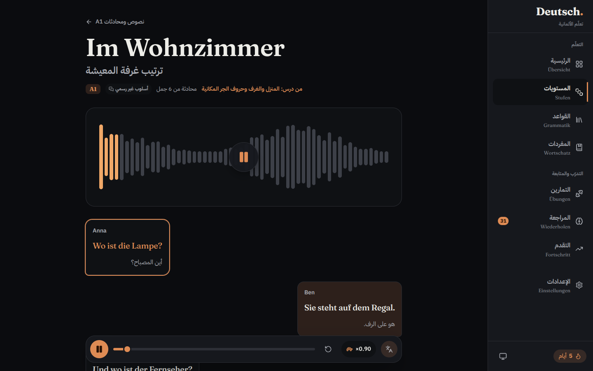<br /><br /><sub><b>Conversation</b> — each line is tappable; the two speakers have a different voice pitch</sub></td>
  </tr>
</table>

<div align="center">
  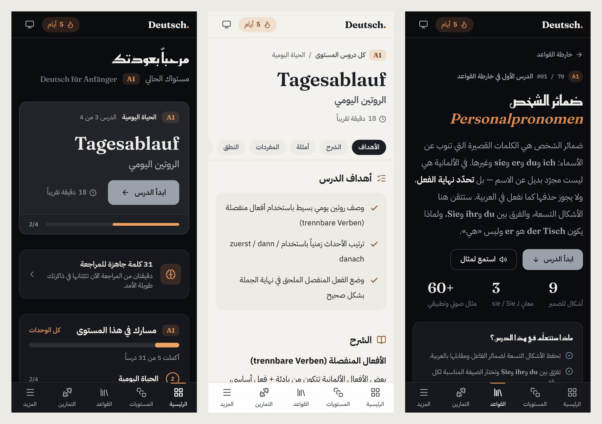
  <br /><br /><sub><b>Mobile</b> — dashboard (dark), lesson (light), grammar rule (dark)</sub>
  <br /><br />
  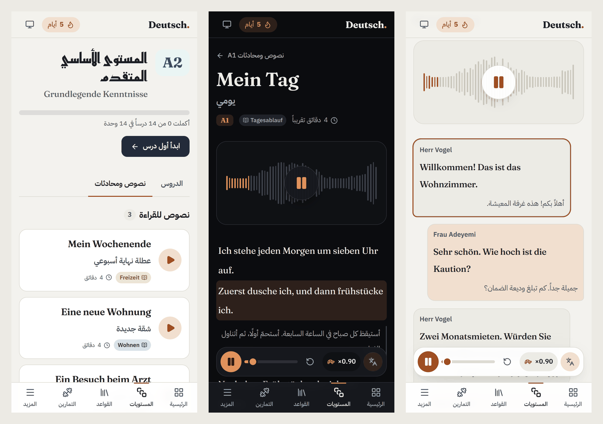
  <br /><br /><sub><b>Mobile</b> — texts &amp; conversations list (light), reading text (dark), conversation (light); the audio bar sits above the bottom navigation</sub>
</div>

## Tech stack

<table align="center">
  <tr>
    <td align="center" width="120"><br /><b>React 19</b><br /><sub>UI</sub></td>
    <td align="center" width="120"><br /><b>TypeScript</b><br /><sub>strict typing</sub></td>
    <td align="center" width="120"><br /><b>Vite 8</b><br /><sub>build tool</sub></td>
    <td align="center" width="120"><br /><b>Tailwind CSS 4</b><br /><sub>styling + tokens</sub></td>
  </tr>
  <tr>
    <td align="center" width="120"><br /><b>Zustand 5</b><br /><sub>client state</sub></td>
    <td align="center" width="120"><br /><b>React Router 7</b><br /><sub>routing</sub></td>
    <td align="center" width="120"><br /><b>Zod 4</b><br /><sub>data validation</sub></td>
    <td align="center" width="120"><br /><b>Lucide</b><br /><sub>icons</sub></td>
  </tr>
  <tr>
    <td align="center" width="120"><br /><b>Vitest 4</b><br /><sub>unit tests</sub></td>
    <td align="center" width="120"><br /><b>Testing Library</b><br /><sub>component tests</sub></td>
    <td align="center" width="120"><br /><b>Playwright</b><br /><sub>end-to-end</sub></td>
    <td align="center" width="120"><br /><b>axe-core</b><br /><sub>accessibility audits</sub></td>
  </tr>
  <tr>
    <td align="center" width="120"><br /><b>Oxlint</b><br /><sub>linting</sub></td>
    <td align="center" width="120"><br /><b>vite-plugin-pwa</b><br /><sub>offline + install</sub></td>
    <td align="center" width="120"><br /><b>Google Fonts</b><br /><sub>typography</sub></td>
    <td align="center" width="120"><br /><b>GitHub Actions</b><br /><sub>CI</sub></td>
  </tr>
</table>

<sub>Icons: official marks from <a href="https://simpleicons.org">Simple Icons</a> (CC0). Zustand, Playwright and axe-core have no entry there, so they are shown as neutral monogram tiles rather than imitations of their logos.</sub>

**Typefaces** — Reem Kufi (Arabic headings), IBM Plex Sans Arabic (Arabic body), Fraunces (German), IBM Plex Mono (phonetics).

Dependencies are kept deliberately small: the runtime dependencies are React, React Router, Zustand, Zod and Lucide. Everything else is tooling.

## How it works

### Architecture

Content, logic, state and UI are separate layers, and dependencies only point one way.

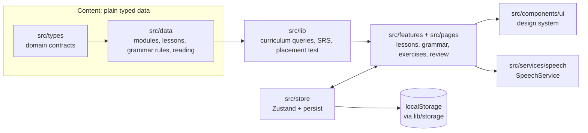

- **Content is data.** Lessons are typed objects in `src/data`, not JSX. A content-integrity test suite validates the whole curriculum — for example, duplicate multiple-choice options or broken links between lessons and grammar rules fail the tests (and therefore CI). Moving content to an API or CMS means changing the data-access layer in `src/lib/curriculum.ts`, not the UI.
- **State is small and separated.** Separate Zustand stores handle progress, grammar progress, settings and theme. All persistence goes through one module (`lib/storage.ts`), which falls back to memory if `localStorage` is unavailable, so private browsing never crashes the app.
- **Services hide providers.** UI components call `speechService`; only `BrowserSpeechService` knows about `SpeechSynthesis`.
- **One view model for texts and conversations.** `lib/stories.ts` turns both kinds of content into a `Story` (blocks plus numbered audio segments), so one page, one audio player and one list serve both. Reading texts are split into sentences; conversations play line by line.
- **Routes are code-split.** Pages — and each grammar rule — are loaded on demand.

### Learner journey

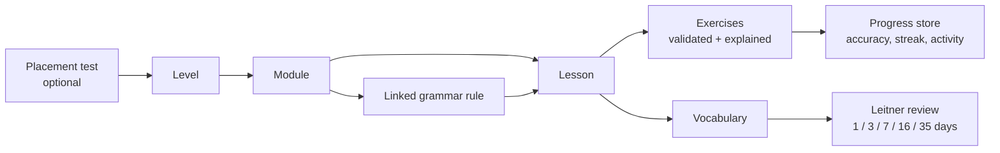

Each lesson runs through: **Objectives → Explanation → Examples → Vocabulary → Pronunciation → Exercises → Common mistakes → Review & completion**. The completion button unlocks once the lesson's exercises are done, and lessons link to the grammar rule that explains them (and back).

### Project structure

```text
src/
├── components/     # layout shell + design-system primitives (ui/)
├── data/           # curriculum as typed data: a1/, a2/, grammar/, reading
├── features/       # dashboard, lessons, grammar, exercises, stories (texts + conversations), review, progress, …
├── hooks/          # shared hooks (e.g. useSpeech)
├── lib/            # pure logic: curriculum queries, SRS, placement test, rich text, storage
├── pages/          # route-level components
├── routes/         # router definition
├── services/       # speech service abstraction
├── store/          # Zustand stores (progress, settings, theme, grammar progress)
├── styles/         # design tokens (light/dark)
├── types/          # domain types
└── utils/          # small helpers (Arabic number agreement, dates, shuffling)
e2e/                # Playwright specs: navigation, accessibility, grammar links
docs/               # design notes, grammar roadmap, screenshots
```

## Getting started

**Requirements:** Node.js `^20.19.0` or `>=22.12.0` (see `.nvmrc`) and npm.

```bash
npm ci          # install exactly what the lockfile specifies
npm run dev     # http://localhost:3000
```

| Script | What it does |
| --- | --- |
| `npm run dev` | Start the dev server (port `3000`, override with `DEV_PORT`) |
| `npm run build` | Type-check, then produce the production build in `dist/` |
| `npm run preview` | Serve the production build locally on `4173` |
| `npm run typecheck` | `tsc -b --noEmit` |
| `npm run lint` | Oxlint |
| `npm test` | Unit and component tests (Vitest) |
| `npm run test:e2e` | End-to-end and accessibility tests (Playwright) |

Copy `.env.example` to `.env` to override local settings. The app needs **no environment variables** to build or run.

<details>
<summary><b>Troubleshooting: <code>listen EACCES: permission denied</code> on Windows</b></summary>

Windows can reserve ranges of ports (typically for Hyper-V / WSL), and Vite's default `5173` can fall inside one. Vite retries another port only when a port is *in use* (`EADDRINUSE`), not when it is forbidden (`EACCES`), so it fails outright. This project defaults to port `3000` and lets you change it:

```bash
# see which ranges Windows has reserved
netsh interface ipv4 show excludedportrange protocol=tcp

# pick any port outside them
DEV_PORT=4000 npm run dev            # macOS / Linux
$env:DEV_PORT=4000; npm run dev      # PowerShell
```

You can also put `DEV_PORT=4000` in `.env`.
</details>

## Quality

- **Type safety:** strict TypeScript across the app, tests and tooling config.
- **Unit and component tests:** 285 tests in 36 files, including a smoke test for *every* lesson and content-integrity suites over the curriculum and the grammar rules.
- **End-to-end:** 86 Playwright tests on desktop and mobile viewports — every route renders without horizontal overflow, unknown routes show the 404 page, lessons and grammar rules link to each other, and **axe-core WCAG 2.1 AA audits** pass in both light and dark themes.
- **CI:** GitHub Actions runs typecheck, lint, tests and build on every push and pull request, then the Playwright suite.

## Deployment

The build output is a static single-page app (`dist/`), so any static host works. Because routing is client-side (`createBrowserRouter`), the host must serve `index.html` for unknown paths — otherwise a refresh on `/levels/a1` returns 404.

| Platform | Setup |
| --- | --- |
| **Vercel** | Import the repository. `vercel.json` provides the SPA rewrite, cache headers and security headers. |
| **Netlify** | Import the repository. `netlify.toml` provides the build settings, SPA redirect and headers. |
| **Cloudflare Pages** | Build command `npm run build`, output directory `dist`. A project without a top-level `404.html` is treated as a single-page app, so no extra file is needed. |
| **Any other static host** | Upload `dist/` and add an “all paths → `/index.html`” rewrite. |

Notes:

- Deploy at the **root of a domain**. The PWA manifest uses absolute paths (`start_url: /dashboard`); hosting under a sub-path needs Vite's `base` option and manifest changes.
- Hashed files in `/assets` are cached for a year; `sw.js` and the manifest are always revalidated so users receive updates.
- No Content-Security-Policy is set yet. The app loads Google Fonts and an inline theme bootstrap script, so a CSP needs a hash for that script — a worthwhile hardening step.

## Roadmap

- Author **B1** and **B2** content (modules, lessons, vocabulary, exercises).
- Finish the grammar roadmap: 34 of 70 rules are authored (all of A1 and A2); the B1 and B2 rules remain.
- Load each level's curriculum on demand — it is currently bundled into the main chunk (see lesson 7 below).
- Add more reading texts (five so far: two in A1, three in A2) and real illustrations for story covers — a story's `image` field is already supported; without one, the cover shows a waveform.
- Evaluate an external TTS provider behind the existing `SpeechService` interface.

## Lessons learned

1. **Treat content as data — and test it like code.** Keeping lessons as typed data made it possible to run an integrity suite over the entire curriculum. It found real defects (such as duplicate options in multiple-choice questions) that nobody would have spotted by reading lessons one by one.
2. **Green tests are not the same as a working product.** Type-checking, linting, 218 tests and the build were all green while quoted German in Arabic paragraphs rendered with its punctuation on the wrong side. It only showed up when the production build was opened in a real browser. Visual QA in both directions (RTL and LTR) belongs in the definition of done.
3. **Bidirectional text is a rendering problem, so fix it in the renderer.** The same pattern appeared in hundreds of authored strings. Rather than editing them, quoted Latin text is wrapped in an LTR isolate by one component (`InlineMarkup`), with unit tests for the edge cases (unbalanced quotes, Arabic quotations, conjunctions glued to a quote).
4. **Accessibility is easier as a design-token decision than as a patch.** Contrast-checked colour pairs, plus a separate “vivid” tier reserved for non-text decoration, fixed a flat-looking UI without compromising text contrast. Automated axe audits keep it that way.
5. **Let dependencies earn their place.** Zod sat unused until progress export/import gave it a real job (validating untrusted files). Search is lazy-loaded so a global feature never taxes the first render.
6. **Put seams where change is likely.** The speech service and the persistence module are where browser APIs enter the app. Both sit behind small interfaces, which is why swapping a TTS provider or surviving blocked storage costs almost nothing.
7. **Measure bundle size, then decide.** The build warned about a 750 kB chunk. The cause is architectural — the whole curriculum is imported statically — so raising the warning limit would only hide it. Splitting third-party code into its own chunks improves caching across deployments and removes the warning legitimately (at the cost of a slightly larger first download); the real fix, per-level lazy loading, is on the roadmap.
8. **Know your toolchain's failure modes.** Vite retries a busy port but not a forbidden one, so a Windows reserved-port range looks like a mysterious crash. A configurable port plus a documented diagnosis turns a blocker into a one-line fix.
9. **Choose the simple model and write down why.** Spaced repetition uses a Leitner box system instead of a full SM-2 ease-factor model because it is easier to reason about and to test while keeping the core benefit; the reasoning lives in the code next to the intervals.
10. **Model the experience, not the file type.** Reading texts and conversations are authored differently, but a learner does the same thing with both: read along with audio. A small `Story` view model lets one page, one player and one list serve both without touching the authored data.
11. **A cancelled action is not a failed one.** Browsers report a replaced or stopped utterance as an error (`canceled` / `interrupted`). Treated as a failure, that would flash an error every time a learner jumped to another sentence, so the speech service now reports it as a normal end — with tests.
12. **Don't hide a fault by styling.** A `hover` style quietly overrode the highlight of the sentence being read, and only a screenshot of the real page showed it. The fix and a regression test went in together.

## Documentation

- [`docs/ui-design.md`](docs/ui-design.md) — visual system, type roles and behaviour rules
- [`docs/grammar-roadmap.md`](docs/grammar-roadmap.md) — the 70-rule grammar order the app follows

## License

No license has been chosen yet; all rights are reserved until a `LICENSE` file is added.
